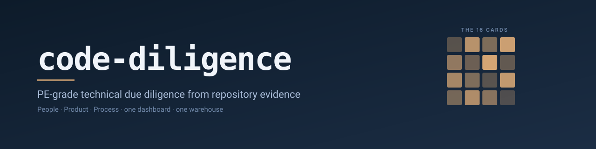

<p align="center">
  
</p>

<p align="center">
  <a href="LICENSE"></a>
  <a href=".claude-plugin/plugin.json"></a>
  <a href="https://claude.com/claude-code"></a>
</p>

---

> **The deal team needs a grounded view of a target's repositories. You need to know who carries bus-factor risk, where the hotspots are, what looks abandoned, and whether engineering hygiene is a problem.**
>
> `code-diligence` answers those questions in one command.

## What you get

One **Observable dashboard** per target, covering **15 cards** across three diligence axes:

| Axis | Cards |
|---|---|
| **People** | bus-factor map · knowledge concentration · contributor activity timeline · communication graph · hero-dependency register |
| **Product** | hotspot map · hidden coupling · code-aging chart · burndown over time · abandoned-area register · language inventory |
| **Process** | Repository delivery indicators · CI health · issue-triage health · working-pattern signals *(privacy-gated, off by default)* |

With the target's warehouse MCP connected, the native narrator adds evidence-grounded prose to each card. A read-only chat agent answers follow-up questions ("why is the payments-service a hotspot?") with citations back to the warehouse and the repo.

## The entire workflow

```text
analyst:  /code-diligence:aeo-diligence-ingest acme --quick
plugin:   [Sources ingested · available tool results and missing inputs recorded]

analyst:  /code-diligence:aeo-diligence-ask acme why is the payments-service a hotspot?
plugin:   [Cites specific commits, contributors, and measured change counts
           from the warehouse — read-only, evidence-anchored.]

analyst:  /code-diligence:aeo-diligence-refresh acme    # before the next deal stage
plugin:   [Incremental fetch + full-tier rerun · analyst-confirmed
           curations preserved.]
```

That is the whole interaction. No notebooks, no SQL, no exports.

## At a glance

|  |  |
|---|---|
| **Quick tier** | Git history plus available lightweight analysis tools |
| **Full tier** | Adds available deep analyzers and enabled GitHub platform data |
| **Reproducibility** | 🔁 idempotent pipeline; analyst-confirmed curations survive every rerun |
| **Privacy posture** | 🔒 repository commit-time heatmaps are off until you explicitly opt in |
| **Processing** | Git analysis runs locally; optional narration sends selected evidence to your configured model provider |
| **License** | 📄 MIT |

## Standing on giants

`code-diligence` doesn't reinvent the underlying analysis — decades of brilliant open-source work already exists. The plugin's job is the *stitching*: one warehouse, one schema, one card map, one dashboard, so a deal team gets diligence-grade signal without learning seven tools first.

The proven analyzers it brings together:

[**git-fame**](https://github.com/casperdcl/git-fame) — authorship + bus-factor signal ·
[**git-of-theseus**](https://github.com/erikbern/git-of-theseus) — code-aging curves ·
[**git-truck**](https://github.com/git-truck/git-truck) — repo visualization ·
[**hercules**](https://github.com/src-d/hercules) — deep commit-history analysis ·
[**code-maat**](https://github.com/adamtornhill/code-maat) — hotspots + temporal coupling (the *Your Code as a Crime Scene* canon) ·
[**repowise**](https://github.com/repowise-dev/repowise) — repo health metrics ·
[**Observable Framework**](https://observablehq.com/framework) — the dashboard runtime

Each tool retains its own license; see each repository. The user experience is meant to transcend any individual tool — you get powerful, evidence-anchored results without needing to know which analyzer fed which card.

## Install

The packaged installation targets Claude Code; individual skills can also be installed in other runtimes.

### Claude Code — full pipeline
```sh
claude plugin marketplace add AeyeOps/aeo-diligence-marketplace
claude plugin install code-diligence@aeo-diligence
```
Commands, hooks, MCP, and the Observable dashboard. The recommended path.

### Other runtimes

The skills are readable outside Claude Code, but this repository packages a Claude Code plugin. Codex can install individual skill directories under `plugins/code-diligence/skills/` with its skill installer. The operational skills also require a shell, the Python project, and a configured warehouse MCP; installing skill text alone does not install those components. Claude Code can use the same skill directories standalone from its skills folder: set `CODE_DILIGENCE_ROOT` to this `plugins/code-diligence` folder and configure the warehouse MCP directly. No Gemini extension manifest is included.

## Configure your first target

> Resolve the plugin root as `PLUGIN_ROOT` from `CLAUDE_PLUGIN_ROOT` inside a Claude Code plugin install, or from `CODE_DILIGENCE_ROOT` for standalone skills; plugin cache paths vary by installation.

Each target has its own folder. Copy the example settings into it as `diligence.local.md`, point it at the GitHub orgs you want to diligence, and set the env var that holds your PAT in your environment:

```sh
mkdir -p ~/data/code-diligence/acme
cp "$PLUGIN_ROOT/skills/aeo-diligence-ingest/templates/diligence.example.local.md" \
   ~/data/code-diligence/acme/diligence.local.md
export ACME_DILIGENCE_GH_TOKEN=ghp_...
```

The settings file selects GitHub organizations or an existing local clone directory. Run the ingest:

```text
/code-diligence:aeo-diligence-ingest acme --quick
```

To enable the asker and narrator, start the session with the target warehouse selected:

```sh
export DILIGENCE_WAREHOUSE_PATH=~/data/code-diligence/acme/warehouse.duckdb
```

For a newly created warehouse, reconnect the plugin MCP or start a new session after ingest. Exporting a variable in a child shell does not retarget an already running server. Standalone skills configure the server directly, as the asking skill's connection reference shows.

The ingest skill then builds the dashboard. Open its configured output with:

```sh
python -m http.server -d ~/data/code-diligence/acme/dashboard
# → http://localhost:8000
```

> **Optional analysis tools** (`git-fame`, `git-of-theseus`, `hercules`, `code-maat`, `repowise`) unlock additional evidence. The skills check availability, explain the results lost through each gap, and establish whether to install/repair it or proceed with reduced coverage. The CLI records tool failures on Health while other analyses continue; a successful CLI exit does not establish full coverage.
>
> Full optional-tool install commands: [Installing the optional analysis tools](#installing-the-optional-analysis-tools) below.

## Reading the output

If you're new to diligence-grade code analysis, the per-axis explainers are the fastest way in — they tell you what each card means and how to read it:

- 👥 [**People axis**](skills/aeo-diligence-axes/references/people.md) — bus factor, knowledge concentration, hero dependencies
- 🧱 [**Product axis**](skills/aeo-diligence-axes/references/product.md) — hotspots, coupling, code aging, abandoned areas
- ⚙️ [**Process axis**](skills/aeo-diligence-axes/references/process.md) — delivery indicators, CI health

When a card shows "low confidence," it means the underlying source data was incomplete — usually because an optional tool wasn't installed or the GitHub token lacked scope. The dashboard's Health page tells you exactly which.

## License

[MIT](LICENSE) · Copyright © 2026 AeyeOps

---

<details>
<summary><strong>Installing the optional analysis tools</strong></summary>

Use the [host installation guidance](skills/aeo-diligence-ingest/references/tool-prerequisites.md#choose-the-installation-environment) to select compatible tools for macOS or Linux on ARM64 or x86_64, or a Linux execution environment on Windows. Use its package manager or mise for git, uv, Node 22+, Go and Java 17+. Install the optional Python CLIs in isolated uv tool environments:

```sh
uv tool install git-fame
uv tool install git-of-theseus
uv tool install repowise
DO_NOT_TRACK=1 repowise telemetry disable
repowise telemetry status
```

Download `code-maat-1.0.4-standalone.jar` from [release v1.0.4](https://github.com/adamtornhill/code-maat/releases/tag/v1.0.4) into the plugin's `vendor/` directory. Hercules needs a binary for the host architecture or a source checkout build; its replacement directives prevent the versioned `go install` shortcut. The [prerequisite reference](skills/aeo-diligence-ingest/references/tool-prerequisites.md) contains the verified build steps, the Linux ARM64 Repowise header remedy, every tool's coverage consequence, and the warehouse MCP connection path.

`git-truck` is invoked via `npx -y git-truck@3.3.0` — no global install is needed. Package downloads and its npm update check use the network. Repowise's adapter explicitly disables usage telemetry. Local analyzers, GitHub collection and hosted agent narration have different network boundaries; see the prerequisite reference before describing a run as local-only.

Which tool feeds which card: [`skills/aeo-diligence-ingest/references/tool-prerequisites.md`](skills/aeo-diligence-ingest/references/tool-prerequisites.md).

</details>

<details>
<summary><strong>For developers and contributors</strong></summary>

This is shipped as a ready-to-use plugin, not an open contribution surface — there is no contribution guide and no roadmap solicitation. That said, if you want to fork, change, or extend it locally:

```sh
uv sync --all-packages
uv run pytest
uv run --directory mcp/diligence-warehouse pytest
uv run ruff check .
uv run pyright src/ mcp/diligence-warehouse/server.py
```

Tests for individual external tools skip cleanly when the binary is absent, so the suite is green even on a bare Mac.

**Internals deeper than the README goes:**

- [Per-tool wrapper notes](skills/aeo-diligence-tool-output/SKILL.md) — what each tool does and which warehouse column it populates
- [Pipeline stages](skills/aeo-diligence-ingest/references/pipeline-stages.md) — ingest stages and the subsequent narration/build steps
- [Working-pattern display setting](skills/aeo-diligence-dashboard/references/privacy-gate.md) — the working-pattern card opt-in
- [Changelog](CHANGELOG.md) — what changed in each release

</details>
